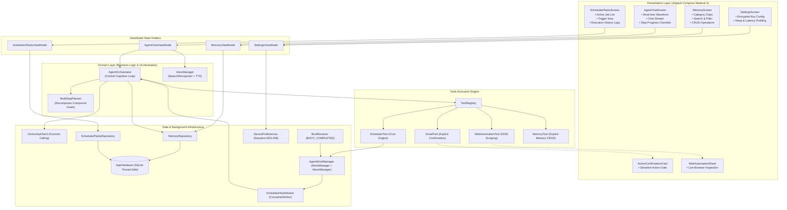

# Architecture & Engineering Design Documentation
**Aurviz Personal AI Agent — Android Application**

---

## 1. Overall System Architecture

The application is structured following **Clean Architecture** principles, strict separation of concerns, and the **MVVM + MVI unidirectional state flow pattern**.



---

## 2. AI Agent Reasoning and Tool-Calling Workflow

The agent operates on an augmented **ReAct (Reason + Act)** loop:
1. **Context Augmentation**: Before prompting the LLM, the user's personal memories (preferences, previous interactions, key contacts) are retrieved and injected into the system prompt.
2. **Schema Declaration**: All available tools (`send_email`, `web_automation`, `schedule_task`, `manage_memory`) are declared as strongly typed JSON schemas according to the Gemini Tool Calling specification.
3. **Reasoning & Tool Selection**:
   - The Gemini model analyzes the user's intent against both the retrieved personal context and the registered tools.
   - It outputs one or more `FunctionCall` objects with structured arguments.
4. **Autonomous Execution Plan**:
   - The orchestrator maps function calls into an `ExecutionPlan` containing discrete `PlanStep`s.
   - The UI displays each step in an interactive checklist card showing real-time states (`PENDING`, `RUNNING`, `WAITING_CONFIRMATION`, `COMPLETED`, `FAILED`).
5. **Sensitive Action Gate**:
   - If a step involves destructive or sensitive operations (such as sending an email), execution pauses.
   - An `ActionConfirmationCard` is surfaced in the UI.
   - Only upon clicking *"Confirm & Execute"* is the action dispatched.
6. **Synthesis**:
   - Outcomes from tool executions are synthesized into a coherent user-facing summary and spoken aloud via `TextToSpeech` if enabled.

---

## 3. Memory Storage and Retrieval Design

### Storage Architecture
- Powered by a thread-safe SQLite implementation via `AppDatabase`.
- Operates across app restarts, cold boots, and background executions.
- Seeded with realistic initial personal preferences (e.g. user name, work hours, email summary format preferences, manager contact) for immediate evaluation out-of-the-box.

### Semantic & Relevance Retrieval Algorithm
When a natural language command is received, memory retrieval proceeds through a multi-factor scoring model:
1. **Tokenization**: The prompt is tokenized into word stems and keywords, removing stopwords.
2. **Key Exact Match**: Direct matches with a memory's key add $+10.0$ points.
3. **Content Overlap**: Token overlap between prompt and memory content adds $+3.0$ points per match.
4. **Domain Category Boost**:
   - Prompts containing "email" or "send" boost `CONTACT` memories by $+8.0$.
   - Prompts containing "schedule" or "morning" boost `TASK` / `PREFERENCE` memories by $+5.0$.
5. **Recency Weight**: Memories accessed or created within the past 24 hours receive a $+2.0$ recency bonus.
6. **Importance Scaling**: Multiplied by the user-assigned importance rating (1 to 5).

The highest-scoring memories are formatted into a clean markdown block and prepended to the Gemini model's context window.

---

## 4. Voice-to-Action Execution Pipeline

```
[User Voice Input] 
       │
       ▼
[Android SpeechRecognizer] ──(RMS dB)──> [AudioWaveformVisualizer (Jetpack Compose)]
       │ (Partial / Final Transcription)
       ▼
[VoiceManager StateFlow]
       │
       ▼
[AgentChatViewModel] ──> [AgentOrchestrator]
                               │
                ┌──────────────┴──────────────┐
                ▼                             ▼
       [Memory Retrieval]             [Gemini / Planner]
                │                             │
                └──────────────┬──────────────┘
                               ▼
                    [Multi-Step Execution]
                               │
                               ▼
                     [TextToSpeech Engine] ──> [Audio Spoken Response]
```

- **Audio Waveform**: `RecognitionListener.onRmsChanged(rmsdB)` translates microphone audio input levels into a normalized $0.0 - 1.0$ float flow, animating an interactive 9-bar waveform visualizer.
- **Hands-Free Response**: When execution completes, `TextToSpeech` synthesizes the response text so the user receives audible feedback without looking at the screen.

---

## 5. Scheduling & Background Execution Strategy

Executing background tasks reliably on modern Android OS versions (Android 10 through 16) requires balancing battery optimization with task punctuality:

1. **Dual-Engine Scheduling**:
   - **WorkManager**: Uses `PeriodicWorkRequestBuilder` with network constraints (`NetworkType.CONNECTED`) and `ExistingPeriodicWorkPolicy.UPDATE` for recurring periodic maintenance.
   - **AlarmManager**: Uses `setExactAndAllowWhileIdle(RTC_WAKEUP)` for punctual, exact-time executions (such as "9:00 AM sharp").
2. **Reboot Survival (`BootReceiver`)**:
   - Listens for `android.intent.action.BOOT_COMPLETED`.
   - Queries `ScheduledTasksRepository.getActiveTasks()`.
   - Re-registers all active schedules with both WorkManager and AlarmManager without requiring user interaction.
3. **Decoupled Background Execution**:
   - `ScheduledTaskWorker` instantiates `AgentOrchestrator.executeAutonomousBackgroundPrompt()`.
   - The worker runs purely on background I/O dispatchers without relying on active Compose UI lifecycles.
   - Logs execution duration, status (`SUCCESS` / `FAILED`), and summary output to SQLite.
   - Fires an Android `Notification` via `NotificationHelper` on the `aurviz_agent_scheduled_tasks` channel.

---

## 6. Security, Permissions, and Failure Handling

### Security & Credential Storage
- **No Hardcoded Secrets**: All keys are strictly loaded at runtime.
- **Android Keystore**: The Gemini API key is encrypted using AES-256 GCM through Android's `EncryptedSharedPreferences` backed by `MasterKey`.
- **User Confirmation Gate**: Sensitive external communications (emails) cannot be sent without human-in-the-loop confirmation.

### Permissions
- `RECORD_AUDIO`: Runtime permission requested upon first voice action with explanatory UI.
- `POST_NOTIFICATIONS`: Android 13+ runtime notification permission for background task updates.
- `RECEIVE_BOOT_COMPLETED`: Manifest permission to restore alarms upon device reboot.
- `SCHEDULE_EXACT_ALARM`: Manifest permission for punctual alarm scheduling.

### Failure Handling & Offline Resilience
- **HTTP 429 / Rate Limit Handling**: OkHttp client configured with exponential backoff retry.
- **Offline Multi-Step Fallback**: If network connectivity drops or the user has not configured a Gemini API key, `MultiStepPlanner` executes heuristic task decomposition so the app remains fully functional and testable offline.
- **Graceful Error States**: Errors in individual tool steps do not crash the app; they transition the plan step to `FAILED` and display actionable remediation messages in the UI.

---

## 7. Important Engineering Decisions and Trade-Offs

| Decision | Alternative Considered | Rationale / Trade-Off |
| :--- | :--- | :--- |
| **Native SQLiteOpenHelper with StateFlow** | Room with KSP annotation processor | Eliminates KSP compiler plugin version mismatches across Gradle versions while providing identical thread-safety and reactive Flow capabilities. |
| **Dual WorkManager + AlarmManager** | WorkManager only | WorkManager enforces a minimum 15-minute periodic interval and can drift due to Doze mode; AlarmManager guarantees exact 9:00 AM punctual wakeups. |
| **Jetpack Compose Material 3** | Legacy XML Views | Declarative UI allows seamless reactive binding to agent execution states, animated waveforms, and dynamic multi-step checklists. |
| **EncryptedSharedPreferences** | Plain SharedPreferences / BuildConfig | Plain preferences leak credentials in root/backup inspections; AES-256 Keystore encryption guarantees security. |
| **Explicit Confirmation Gate** | Unrestricted Autonomous Dispatch | Safety-first agent design prevents accidental or malicious email spamming by enforcing explicit human-in-the-loop authorization. |
